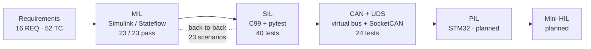

# Power Window ECU – End-to-End Verification


A power window ECU with anti-pinch protection, verified along the V-model: from requirements through
**Model-in-the-Loop**, **Software-in-the-Loop** and a **CAN/UDS network**, with automated tests,
back-to-back comparison, coverage, static analysis and CI. Personal learning and portfolio project.

| | |
|---|---|
| Requirements | **16** (incl. one change request, CR_01) |
| Test cases | **52**, traced to requirements |
| Automated tests | **87** on every push (SIL, back-to-back, CAN, UDS) + **23** MIL tests in MATLAB |
| Model vs. code | **100 % identical**, every signal every 10 ms (back-to-back) |
| Code coverage | **96 % lines** (only defensive code uncovered) |
| Static analysis | cppcheck + MISRA C:2012 addon, 1 documented deviation |
| Defects found | **9** (design, code, model, test tool, requirements) |

## How it fits together



The same test cases run at every level; only the "in-the-loop" part changes.

## The feature

The driver presses Up or Down; the switch request arrives over CAN from the body control module (BCM).
The door ECU drives the motor, stops at the end positions, and **reverses if something is trapped**
while the window closes.

| Function | Requirements |
|---|---|
| Up / down / stop / end positions | REQ_01 – REQ_04 |
| Anti-pinch: detect > 8 A between 4 and 96 %, reverse ≥ 20 %, no re-closing until released | REQ_05 – REQ_07, REQ_13, REQ_14 |
| Protection: voltage 9–16 V, CAN timeout > 500 ms (any state), motor overrun > 8 s, Up+Down | REQ_08 – REQ_11 |
| CAN status message every 100 ms | REQ_12 |
| UDS diagnostics (0x10, 0x22, 0x19, 0x14, 0x3E), DTCs U0140-00 and B1310-00 | REQ_15, REQ_16 |

Controller states: `IDLE`, `MOVING_UP`, `MOVING_DOWN`, `PINCH_REVERSE`, `WAIT_RELEASE`, `ERROR`.

## Test levels

| Level | What runs | Where | Result |
|---|---|---|---|
| **MIL** | Stateflow controller + plant model, automated harness, fault injection | [`01_MIL/`](01_MIL) | 23 / 23 pass ([report](reports/MIL_test_report.md)) |
| **SIL** | Hand-written C99 controller via ctypes, Python plant, pytest | [`02_SIL/`](02_SIL) | 40 tests pass |
| **Back-to-back** | MIL reference data vs. SIL, all signals every 10 ms | `02_SIL/tests/test_back_to_back.py` | 23 / 23 identical |
| **CAN** | DBC, 4-node virtual network (BCM, ECU, tester, logger), cycle times, timeouts | [`03_CAN/`](03_CAN) | 11 tests pass |
| **UDS** | ISO-TP + UDS server in the ECU: read data, read/clear DTCs, negative responses, P2 | [`03_CAN/`](03_CAN) | 13 tests pass |
| **Live** | ECU in real time on Linux SocketCAN `vcan0`, driven with can-utils | [`03_CAN/README.md`](03_CAN/README.md) | manual script |
| PIL | Controller on an STM32 board | `04_PIL/` | planned |
| HIL | Real-time plant ↔ MCU over CAN | `05_HIL/` | planned |

## What testing found

| # | Found by | Defect | Fix |
|---|---|---|---|
| 1 | Requirement × state matrix | No fault handling during pinch reversal | Added transitions, TC_20 |
| 2 | MIL test | Window re-closed on a trapped hand while Up was held | New state `WAIT_RELEASE`, REQ_13, TC_21 |
| 3 | MIL test | Pinch flag cleared too early | REQ_14 |
| 4 | Requirement review | REQ_06 physically impossible (20 % in 200 ms) | Reworded |
| 5 | Code review + SIL tests | ERROR recovery checked "Up pressed" instead of "released" | One missing `!` fixed, TC_22 |
| 6 | Back-to-back | Model initialised the position to 50 % at power-on | Unit Delay initial condition |
| 7 | Coverage | 9 transitions and 5 conditions never tested | TC_23 – TC_36, sensor fault injection |
| 8 | Tool self-test | MISRA check silently reported nothing (misconfigured) | `--enable=style`, self-test file |
| 9 | Live SocketCAN test | Dead BCM not detected while the window was idle | Change request **CR_01**, TC_49 – TC_53 |

Open points and out-of-scope items (E2E protection, engine-off / locking behaviour, crash behaviour) are
listed in [`docs/requirements.md`](docs/requirements.md).

## Run it

```bash
# Linux / WSL, from the repo root
python3 -m venv .venv && source .venv/bin/activate
pip install pytest gcovr cantools python-can
sudo apt install -y gcc cppcheck            # static analysis
bash run_all.sh                             # MISRA + 87 tests + coverage gate (>= 90 %)

python3 03_CAN/sim/run_demo.py              # lost CAN message -> ERROR after 510 ms
python3 03_CAN/sim/run_uds_demo.py          # UDS session frame by frame
```

MIL: open `01_MIL/model/PowerWindow_MIL.slx` in MATLAB/Simulink and run `run_mil_tests` from `01_MIL/tests/`.
The live SocketCAN demo is described in [`03_CAN/README.md`](03_CAN/README.md).

CI (GitHub Actions) runs the MISRA check, all SIL/CAN/UDS tests, back-to-back and the coverage gate on every push.

## Documents

- [Requirements](docs/requirements.md) · [Test specification](docs/test_specification.md) · [Traceability](docs/traceability.md)
- [CAN / UDS guide with glossary and exercises](03_CAN/README.md)
- [Tools and skills log](docs/tools_and_skills.md)

## Tools

MATLAB · Simulink · Stateflow · C99 · gcc · Python · pytest · ctypes · gcov / gcovr · cppcheck (MISRA C:2012) ·
CAN · DBC · cantools · python-can · SocketCAN · can-utils · ISO-TP · UDS (ISO 14229) · Git · GitHub Actions

## Project structure

```
docs/       requirements, test specification, traceability, tools log
01_MIL/     Simulink/Stateflow model + MATLAB test harness
02_SIL/     C controller (src/) + pytest harness, back-to-back (tests/)
03_CAN/     DBC, virtual CAN network, UDS, live SocketCAN demo, CAN/UDS tests
04_PIL/     planned: STM32
05_HIL/     planned: mini-HIL
reports/    MIL report, back-to-back reference data and report, static analysis
run_all.sh  local pipeline, same steps as CI
```
